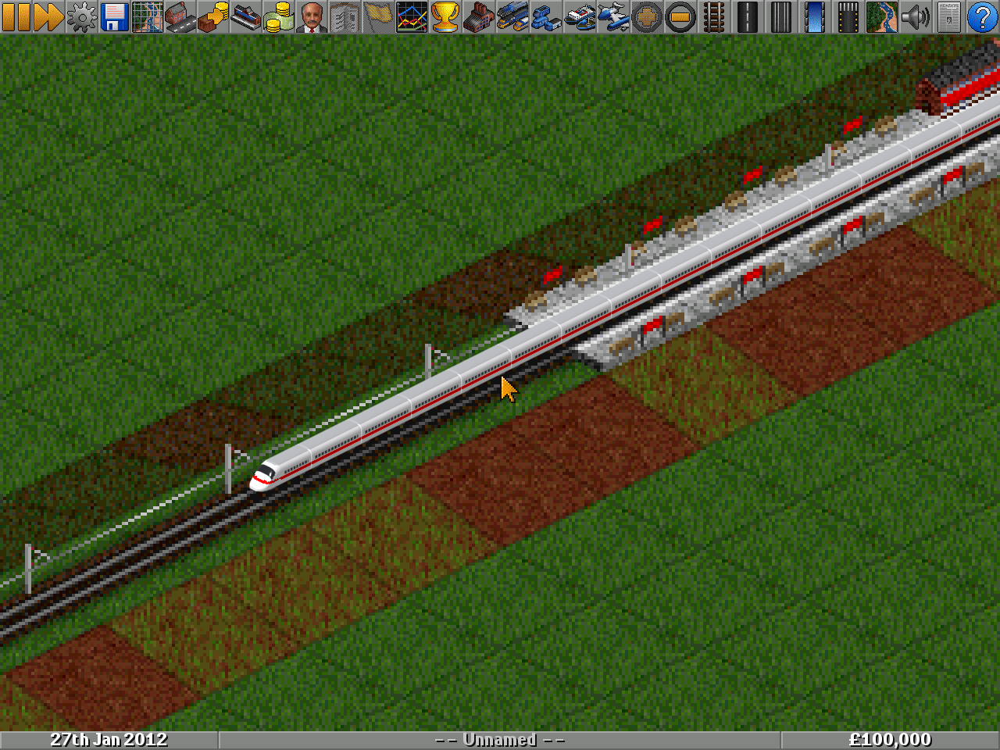

# OpenTTD-Max

以 OpenTTD 為引擎的高解析度車輛套件（NewGRF）：協和號、Airbus / Boeing 主要客貨機、各代新幹線與磁浮列車，全部以 32bpp + 4x extra zoom 製作。

| 文件 | 內容 |
|---|---|
| [docs/PLAN.md](docs/PLAN.md) | 企劃書（範圍、內容清單、機制設計、美術管線、時程） |
| [docs/M0-REPORT.md](docs/M0-REPORT.md) | M0 技術驗證報告 |
| [docs/M1-REPORT.md](docs/M1-REPORT.md) | M1 管線定稿報告（比例校正、參數化產生器、OpenTTD 15.3 實機驗證） |
| [data/README.md](data/README.md) | CSV 欄位定義 |

**目前狀態：M1 完成**。P0 共 12 款（協和號、737-800、747-400、747-8F、777-300ER、A320、A380、0 系、N700、E5、Transrapid、L0）已完成 32bpp 4x 算圖並在 OpenTTD 15.3 驗證；其餘 P1 / P2 車種暫用佔位圖。



## 建置

```bash
pip install nml==0.9.0 pillow numpy
make            # 驗證資料 -> 產生 NML -> max-air.grf + max-rail.grf
make test-grf   # 無 badges 版本（OpenTTD 13 / 14 測試用），輸出到 build/test/
```

產出的 `max-air.grf`、`max-rail.grf` 複製到 OpenTTD 的 `newgrf/` 目錄即可使用（需 OpenTTD 15.0+、32bpp blitter）。

## 算圖（需要 Blender 的 Python 模組 bpy）

```bash
uv venv --python 3.11 /opt/bpyvenv && uv pip install --python /opt/bpyvenv/bin/python bpy pillow numpy
make render BPY_PYTHON=/opt/bpyvenv/bin/python   # models/**/*.py -> build/render/
make gfx                                         # build/render -> gfx/<cat>/<id>/ sprite sheets
make                                             # 重新編譯 GRF
```

## 新增一款車輛

1. 在 `data/aircraft.csv` 或 `data/trains.csv` 加一列（欄位見 `data/README.md`），`art` 欄填模型名稱。
2. 在 `models/aircraft/<art>.py` 或 `models/trains/<art>.py` 寫參數檔（參考現有檔案，尺寸用公尺）。
3. `make render && make gfx && make`。不需要手改任何 NML。

## 遊戲內自動截圖（Linux）

```bash
tools/ingame/build_openttd.sh 15.3 /opt/openttd-15.3     # 或 apt install openttd（13.4，需 make test-grf）
make && python3 tools/ingame/run.py --openttd /opt/openttd-15.3/build/openttd --grf-dir .
python3 tools/calibrate.py trains/n700:mid=2953            # 與 OpenGFX 原版 sprite 比對尺寸
```

## 目錄

```text
data/      車輛數值 CSV（唯一數值來源）
models/    參數化模型：lib/ 產生器，aircraft/、trains/ 每款一份參數檔
gfx/       後製完成的 sprite sheet 與 manifest（提交到 repo，CI 直接編譯）
src/       手寫 NML 片段（grf 區塊、badges、railtype）
lang/      靜態字串（英 / 繁中 / 日），車輛名稱由 CSV 產生
tools/     render.py、postprocess.py、gen_nml.py、validate.py、ingame/
docs/      企劃書、階段報告、可編譯範例
```
