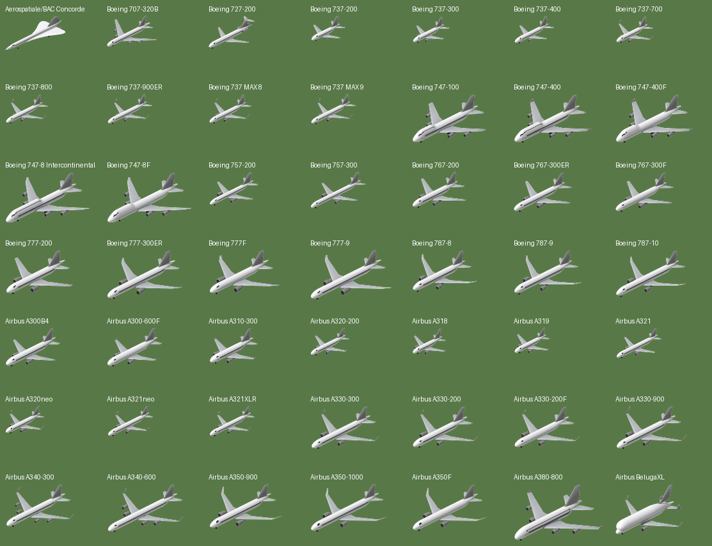
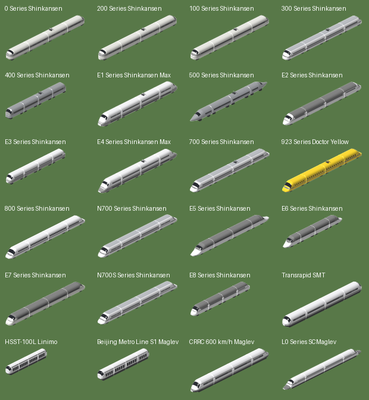

# OpenTTD-Max

以 OpenTTD 為引擎的高解析度車輛套件（NewGRF）：協和號、Airbus / Boeing 主要客貨機、各代新幹線與磁浮列車，全部以 32bpp + 4x extra zoom 製作。

| 文件 | 內容 |
|---|---|
| [docs/PLAN.md](docs/PLAN.md) | 企劃書（範圍、內容清單、機制設計、美術管線、時程） |
| [docs/M0-REPORT.md](docs/M0-REPORT.md) | M0 技術驗證報告 |
| [docs/M1-REPORT.md](docs/M1-REPORT.md) | M1 管線定稿報告（比例校正、參數化產生器、OpenTTD 15.3 實機驗證） |
| [docs/M3-REPORT.md](docs/M3-REPORT.md) | M3 內容報告（全部車種完成、GRF 參數） |
| [docs/M4-REPORT.md](docs/M4-REPORT.md) | M4 報告（平衡、1950–2050 完整一局測試、發布準備） |
| [docs/M5-REPORT.md](docs/M5-REPORT.md) | M5 報告（裝卸速度、跑道與機場等級、音效、自由編組） |
| [docs/M6-REPORT.md](docs/M6-REPORT.md) | M6 報告（艙等配置 refit、貨物老化） |
| [docs/CATALOG.md](docs/CATALOG.md) | 車種型錄（縮圖、三語名稱、數值） |
| [docs/BALANCE.md](docs/BALANCE.md) · [docs/TIMELINE.md](docs/TIMELINE.md) | 平衡對照表 · 可購時間軸 |
| [docs/RELEASE.md](docs/RELEASE.md) | 發布與 BaNaNaS 上架步驟 |
| [data/README.md](data/README.md) | CSV 欄位定義 |
| [docs/AI.md](docs/AI.md) | MaxTransit AI 設計文件（CargoDist 客運網、安全第一、節省時間） |

**目前狀態：M5 玩法更新（GRF 版本 3）**。49 款飛機與 24 款列車模型（共 80 筆車種資料）全部完成 32bpp、最高 4x 的正式算圖；成本已對照原版車輛平衡，並在 OpenTTD 15.3 跑完 1950–2050 完整一局。M5 修正了裝卸速度、依起飛跑道長度分出小型 / 大型機並在購買視窗列出適用機場，加入自製起降與發車音效。發布步驟見 docs/RELEASE.md。





## MaxTransit AI

`ai/MaxTransit/` 是一個以 CargoDist 為核心的客運 AI：公車、鐵路、飛機各自負責最適合的距離，城鎮車站 join 成轉乘樞紐，新鐵路從既有車站分岔共用。優先順序是**乘客安全**（不建平交道、單線只跑一列車、複線用單向路徑號誌、大型機不去小機場、隨機墜機開啟時預設不載客飛行），其次是**門到門時間**，最後才是收益。支援原版車輛與本套件的固定 / 自由編組。安裝：把 `ai/MaxTransit/` 複製到 OpenTTD 的 `ai/` 資料夾，或 `make ai-bundle` 產生 tar。設計與測試結果見 [docs/AI.md](docs/AI.md)。

## GRF 參數

| 套件 | 參數 | 預設 |
|---|---|---|
| `max-air.grf` | 停用原版飛機 | 關 |
| `max-air.grf` | 裝卸速度：標準（8 步裝滿）/ 快（4 步）/ 很快（2 步）/ 原版（每步固定 20 單位） | 標準 |
| `max-air.grf` | 音效：OpenTTD-Max 音效（起飛、觸地）/ 遊戲原版音效 | OpenTTD-Max |
| `max-air.grf` | 乘客舒適度（貨物老化）：開啟 / 關閉 | 開啟 |
| `max-rail.grf` | 停用原版磁浮機車 | 關 |
| `max-rail.grf` | 裝卸速度：標準 / 快 / 很快 / 原版（每節每步 5 單位） | 標準 |
| `max-rail.grf` | 音效：OpenTTD-Max 音效（新幹線、磁浮發車）/ 遊戲原版音效 | OpenTTD-Max |
| `max-rail.grf` | 編組方式：固定編組 + 自由編組 / 只有固定編組 / 只有自由編組 | 兩者 |
| `max-rail.grf` | 乘客舒適度（貨物老化）：開啟 / 關閉 | 開啟 |

裝卸步驟：飛機每 20 tick、列車每 40 tick 一步（一天 74 tick），只在遊戲設定「漸進式裝卸」開啟時有效。未設定 `loading_speed` 的 NewGRF 車輛在 OpenTTD 裡每步只裝 1 單位，這是 1.0 版裝卸極慢的原因。

購買視窗另顯示每款飛機的起飛跑道長度與適用機場（≤ 2,100 m 為小型機，可安全使用小機場與通勤機場；其餘為大型機，在這兩種機場降落有墜機風險），以及每列車的編組長度與所需月台格數。

**艙等配置**：在機庫 / 機廠的改裝視窗裡，乘客有三種配置可選。飛機：標準（兩艙等）/ 高密度（全經濟艙，座位 +15%，票價隨運輸時間減少較快）/ 豪華（三艙等，座位 −20%，票價減少減半）；列車：標準 / 全普通車（+12%）/ 綠色車廂加強（−15%）。

**貨物老化**：OpenTTD 的票價只看距離、運輸時間與貨物種類，不能對頭等艙收更高票價，所以「舒適度」用 `cargo_age_period` 表現：快而舒適的車輛讓票價隨時間減少得較慢（協和號 2 倍、廣體機 1.25 倍、新幹線 1.25 倍、高速磁浮 1.5 倍；豪華艙等再 ×2、高密度 ×0.75）。效果刻意溫和：40 天的航程 2 倍老化週期約多賺 3%，100 天約多 18%，見 docs/BALANCE.md。參數可關閉。

**自由編組**：每個車系除了固定編組，還有「先頭車 ×2」（一輛雙頭機車，兩端都是先頭車）和「中間車」兩個購買項目。買先頭車後，把任意數量的同系列中間車拖到兩節先頭車之間，就能組出符合月台長度的列車；中間車有動力（每節加上該車系每節的功率），其他車系的車廂無法加掛。先頭車列在固定編組的變體群組裡，中間車在車廂區。

## 建置

```bash
pip install nml==0.9.0 pillow numpy
make            # 驗證資料 -> 產生 NML -> max-air.grf + max-rail.grf
make test-grf   # 無 badges 版本（OpenTTD 13 / 14 測試用），輸出到 build/test/
make bundle     # BaNaNaS 格式 tar，輸出到 build/bundle/
make sounds     # 重新合成 sounds/*.wav（tools/make_sounds.py，純程式合成、無錄音）
```

產出的 `max-air.grf`、`max-rail.grf` 複製到 OpenTTD 的 `newgrf/` 目錄即可使用（需 OpenTTD 15.0+、32bpp blitter）。

## 算圖（需要 Blender 的 Python 模組 bpy）

```bash
uv venv --python 3.11 /opt/bpyvenv && uv pip install --python /opt/bpyvenv/bin/python bpy pillow numpy
make render BPY_PYTHON=/opt/bpyvenv/bin/python   # models/**/*.py -> build/render/
make gfx                                         # build/render -> gfx/<cat>/<id>/ sprite sheets
make                                             # 重新編譯 GRF
```

## 新增一款車輛

1. 在 `data/aircraft.csv` 或 `data/trains.csv` 加一列（欄位見 `data/README.md`），`art` 欄填模型名稱。
2. 在 `models/aircraft/<art>.py` 或 `models/trains/<art>.py` 寫參數檔（參考現有檔案，尺寸用公尺）。
3. `make render && make gfx && make`。不需要手改任何 NML。

## 遊戲內自動截圖（Linux）

```bash
tools/ingame/build_openttd.sh 15.3 /opt/openttd-15.3     # 或 apt install openttd（13.4，需 make test-grf）
make && python3 tools/ingame/run.py --openttd /opt/openttd-15.3/build/openttd --grf-dir .
python3 tools/calibrate.py trains/n700:mid=2953            # 與 OpenGFX 原版 sprite 比對尺寸
python3 tools/gallery.py trains -o build/gallery.png        # 由 sprite sheet 產生圖鑑
python3 tools/balance.py && python3 tools/catalog.py         # 平衡表、型錄
```

## 目錄

```text
data/      車輛數值 CSV（唯一數值來源）
models/    參數化模型：lib/ 產生器，aircraft/、trains/ 每款一份參數檔
gfx/       後製完成的 sprite sheet 與 manifest（提交到 repo，CI 直接編譯）
src/       手寫 NML 片段（grf 區塊、badges、railtype）
lang/      靜態字串（英 / 繁中 / 日），車輛名稱由 CSV 產生
tools/     render.py、postprocess.py、gen_nml.py、validate.py、ingame/
docs/      企劃書、階段報告、可編譯範例
```
