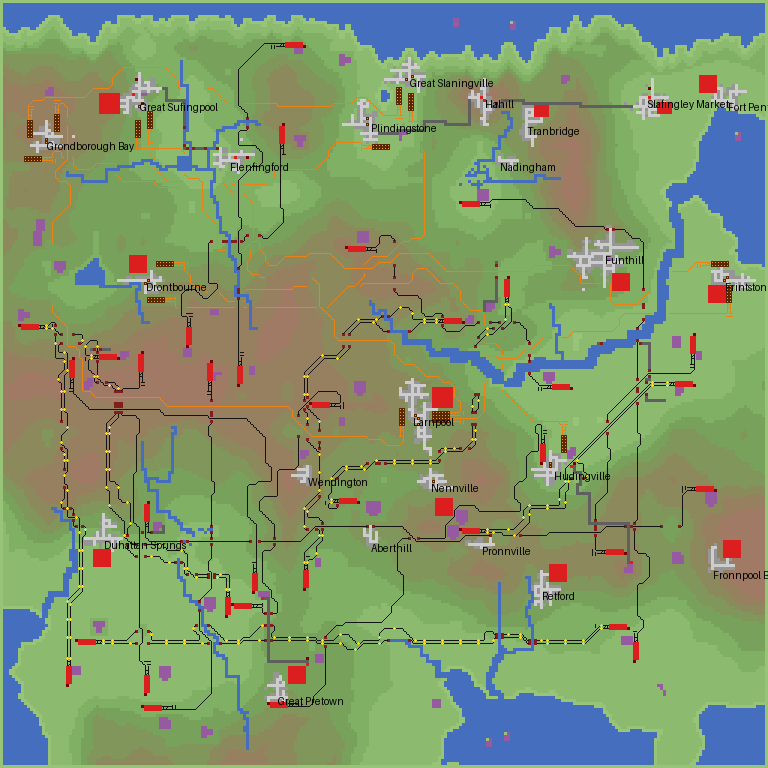
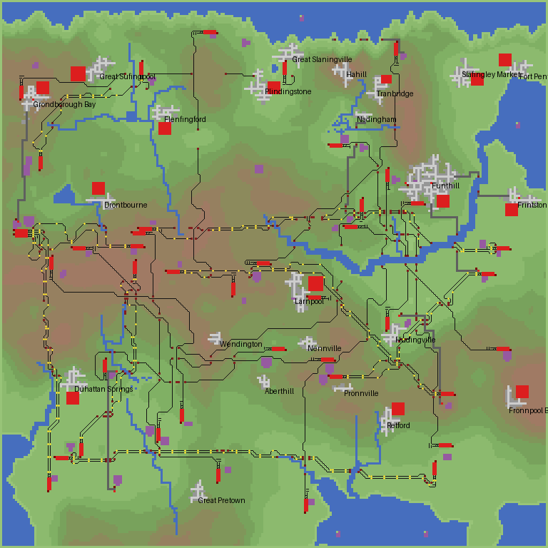
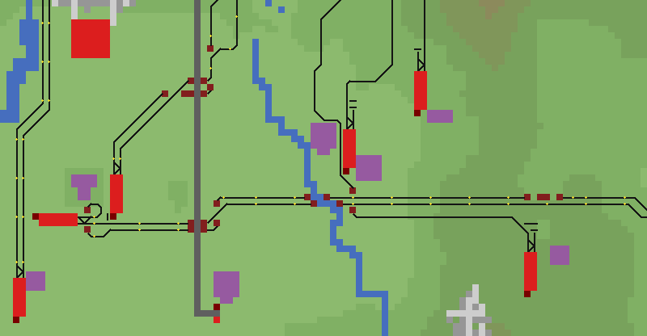

# MaxTransit2：賺錢快、四運具、路線好看、不搶別人的 AI

| 項目 | 內容 |
|---|---|
| 日期 | 2026-10-17 |
| 目標 | 設計一個新 AI（v2）：發展快速、賺錢優先，鐵路／公路／航空／海運都用，路線蓋得好看，不搶人類玩家的城市或路線 |
| 位置 | `ai/MaxTransit2/`（Squirrel，OpenTTD Script API 15，約 6,900 行）。MaxTransit 1（`ai/MaxTransit/`）不變，兩者是不同的 AI，可以同場 |
| 結果 | 在 OpenTTD 15.3（macOS Steam 版，無頭模式）跑 9 種情境共 90 個遊戲年（含存檔讀檔與打包 tar 測試；另有 2 局畫圖用的 30 年），**全部 0 腳本錯誤**；另在 12 張 512² 地圖上做了約 150 局對照實驗來決定設計取捨。同一張地圖上，年度車輛利潤從第 2 年起是 MaxTransit 1 的 3–8 倍，最後一年約 3.4–4 倍；與另一家公司同場時，對方服務的城鎮與產業一律不碰 |

## 1. 三個目標的優先順序

1. **不搶**：其他公司服務中的城市、產業、路線一律不納入候選；動工前再查一次。這是硬性限制，不和收益比較。
2. **賺錢快**：在不搶的範圍內，以「年利潤 ÷（花費占可用資金的比例 ＋ 施工天數占半年的比例）」排序，客運、貨運、四種運具放在同一張表上比。
3. **好看**：路線的線形、雙軌、號誌、橋、樹木、拆除，全部寫在施工規則裡，不是事後修飾。

MaxTransit 1 的優先順序是「乘客安全 → 時間 → 收益」。v2 把收益放到前面，但保留那些同時也在保護錢的安全規則：不建平交道、單線只跑一列車、複線用單向路徑號誌、大型機永不降落小機場、不在會淹水的地方施工。差別在於 v2 預設**會飛**（隨機墜機開啟時也飛），並把墜機的期望損失算進航線評估。

## 2. 遊戲機制依據（OpenTTD 15.3 原始碼查證）

| 主題 | 原始碼 | 對設計的影響 |
|---|---|---|
| AI 能否分辨人類公司 | `script_company.hpp` 沒有任何「是否為人類」的查詢；`ScriptClient`、`ScriptClientList` 標為 `@api game`（只有 Game Script 能用） | AI 無法分辨，所以「不搶」對**所有其他公司**一視同仁 |
| 城鎮「有人在服務」 | `station_cmd.cpp`：新車站建立時，該站最近的城鎮會 `have_ratings.Set(公司)`；`town_cmd.cpp` 的 `ChangeTownRating` 也會設定 | `AITown.GetRating(town, 公司) != NONE` 是便宜的預篩，沒有任何其他公司評價的城鎮不必掃地圖 |
| 地方政府拒絕建站 | `CheckIfAuthorityAllowsNewStation`：評價 ≤ −200 拒絕；砍一棵樹 −35（`RATING_TREE_DOWN_STEP`），整地會把外圈的樹一起清掉 | 站址的樹木額度是「到 −200 的一半」，需要整地時外圈的樹也算進去；砍的樹在附近補種（每棵 +7） |
| 碼頭 | `CmdBuildDock`：陸地格必須是單向斜坡，前方一格是平的水、再前一格也是水 | 大多數海岸格不是單向斜坡：v2 會抬高遠離水面的一兩個角，做出可以建碼頭的斜坡 |
| 兩條平行斜線共用一格 | 一格可以同時有 NW_NE＋SW_SE 或 NW_SW＋NE_SE 兩段半格軌道（平行、不相交）；`BuildSignal` 依前方格子分辨兩段 | 第二條軌道在斜線段可以共用第一條的格子，做出緊密的雙斜線 |
| 船速 | `ShipAccelerate`：和其他車種一樣，每格 2048 / 速度 tick | 一個時間模型適用四種運具 |
| 飛機故障 | `aircraft_cmd.cpp`：故障中的飛機限速 320 km/h，這個上限不隨「飛機速度」設定縮放，在預設的 1/4 速度下約只剩正常的三分之一，要到降落才恢復；`vehicle.cpp`：遊戲預設「故障：減少」，保養會恢復可靠度並把故障累積歸零 | 長航線的實際時間常比估計長很多；等候的旅客多不代表飛機不夠，加機要看實際獲利 |
| 雕像 | `UpdateStationRating`：公司在車站所屬城鎮有雕像時評價 +26 | 後期閒置資金的用途之一 |
| 無頭模式截圖 | `null_v.cpp` 強制使用 null blitter，也不處理主執行緒佇列 | 無法截圖；改由 AI 把地圖寫進日誌，`tools/ai/render_map.py` 畫成俯視圖（本文的圖都是這樣產生的，不是遊戲畫面） |
| `start_ai` 參數 | `ConStartAI`：參數最多 3 個，AI 設定必須是**一個**以逗號分隔的參數 | 修正測試工具 `--ai-settings`（原本空格分隔時 AI 不會啟動，遊戲會改起一個隨機 AI） |

## 3. 策略

### 3.1 不搶（`lib/neighbours.nut`）

**判定「別人的」**：

- **城鎮**：在城鎮半徑（6 + min(16, √人口 / 3) 格）內有其他公司的車站、對方總部在附近、或對方持有獨家運輸權。先用評價預篩，只有對方有評價的城鎮才掃描車站格。
- **產業**：產業的集貨範圍內（半徑 5）有其他公司的車站，或我們沒服務卻有貨被運走（排除我方為鄰近產業建的車站順帶載走的情況）。
- **緩衝**：其他公司的車站與總部周圍 5 格不施工（設定為「保持距離」時 10 格）；我方車站的集貨範圍不能碰到對方車站＋緩衝、也不能伸進對方城鎮；集貨站不能涵蓋對方正在服務、生產同一種貨物的產業（否則會分走對方的貨）；我方鐵路與新道路不貼著對方的軌道鋪（以免擋住對方日後的第二條軌道或支線）；公車站不建在對方的道路上；道路一律以橋越過鐵路，不會在任何人的軌道上造出平交道。
- **不做的事**：不買獨家運輸權、不賄賂、不在對方的城鎮做任何城鎮行動。

**動態**：判定每 90 天重查一次，動工前再查一次。如果對方之後才進入我們已經服務的城鎮，v2 保留既有服務、**不再在那裡擴張**，並在日誌記下「places they joined after us」。

**測試（情境 C、D）**：以 MaxTransit 1 作為「另一家公司」同場 10 年。



*圖 1　與情境 C 同設定、另開地圖傾印的一局，第 10 年的俯視圖（`render_map.py` 繪製）：橘色是另一家公司（MaxTransit 1）的軌道與車站，集中在北半部；黑線、紅色是 v2。v2 避開對方的 9 個城鎮與 2 個產業；圖中少數同時有雙方設施的城鎮，都是 v2 先建、對方後到（日誌記錄 7 處），v2 在那些地方沒有再擴建。*

### 3.2 賺錢快（`lib/planner.nut`、`lib/economy.nut`、`lib/engines.nut`、`lib/fleet.nut`、`lib/finance.nut`）

**候選路線**：

| 類型 | 來源 → 去處 | 運具與距離 |
|---|---|---|
| 貨運 | 月產值最高的 45 座產業（煤礦、森林、農場、油井、油井平台⋯）→ 最近的 6 座收貨產業；貨物、食物、水也可以送到城鎮 | 公路 12–70 格、鐵路 30–220 格、海運（兩端都到得了同一片海） |
| 客運 | 人口前 40 名城鎮的兩兩組合 | 公車 15–55 格、鐵路 35–220 格、航空 80 格以上（前 20 大城鎮）、渡輪 20–200 格（兩端都臨海） |

**評估**：`Economy.Evaluate` 用和遊戲付款相同的 `AICargo.GetCargoIncome(貨物, 直線距離, 運輸天數)`，算入滿載等待、可靠度、營運費與折舊；`EngineAdvisor` 為每條路線挑車型（年利潤 − 資金成本 × 車價；資金充裕時資金成本從 30% 降到 10%，改選更快更大的車）。貨運列車依產量決定車廂數；有客座的動車組不拉貨。

**客運的邊際客源模型**：在 CargoDist 下，一個城鎮的旅客會分散到整個網路的所有目的地。所以一條新路線只有把**尚未接入網路的城鎮**接進來時才算新增客源；兩端都已在網路中的路線只算 20%（較短的行程、多出的運能）。早期版本用「各自的客源」計算，結果一直加開同一批城市間的航線，利潤卻停滯。

**分數**：`年利潤 ÷（花費 / 可用資金 ＋（施工天數 ＋ 10）/ 180）`。資金少時便宜的路線先做，資金多時施工快的先做。施工天數依運具與距離估計，每完成（或失敗）一個工程就以實際天數修正。

**四種運具都用上**：每種運具在擁有兩條路線之前，候選分數乘以 1.5。船慢、單條利潤低，沒有這個加權時，高海平面地圖上十年都輪不到海運；在 12 張 512² 地圖的對照實驗中，加權後平均公司價值反而略高（見 6.1）。

**從結果學習**：每條路線營運滿一個日曆年後，比較實際利潤和建造時的原始估計，按「客運／貨運 × 運具」做移動平均，修正之後的所有估計。最終測試中客運航空被修正到 41–82%，鐵路貨運 93–106%，公路貨運 71–118%。

**機場型式**：規劃時以城鎮容得下、預算允許的最大安全型式估算。蓋不下時只退到計畫機種仍能起降的型式（大型機不退到小機場或通勤機場）；連那些都蓋不下就放棄這個計畫、記住該城鎮蓋不下哪些型式，下一輪用剩下的型式重新估算。早期版本會直接退到通勤機場，一條估計每年 £49 萬的航線因此只能飛小飛機，實際只賺 £5 萬。

**車隊**：等候的貨物或旅客超過約一車、或規劃運量接近運能時加車。但去年全年在役的車有四分之一以上虧損，或平均利潤低於「車價 × 資金成本率」（缺錢時 30%、充裕時 10%，和新路線的門檻一致），就不再加車，並每兩個月撤下一輛最舊的車。車站與機場的容量上限用**無延誤的估計來回時間**計算：實測的來回時間包含排隊，拿它算會讓越擠的機場看起來越空，形成正回饋。早期版本曾出現一條航線加到 27 架飛機、全年只賺 £5.6k，年度檢討賣一架、隔月又加回一架。

**長工程期間**：一條鐵路的路徑搜尋常要數週（AI 每遊戲天只有約 19 萬 opcode）。搜尋期間 AI 仍處理事件、賣車、量測行程，並照常做年度檢討與報告；每週的車隊調整與每月的汰換則等工程結束再做，因為它們會占用搜尋的運算額度（對照實驗中這樣做的公司價值少約五分之一）。等列車開進機廠時 AI 本來就閒著，就照常做全部的日曆工作。早期版本在工程跨過新年時，曾整整漏掉一年的年度檢討。

**資金**：開局借滿貸款立即投入；只有在沒有任何值得蓋的工程時才還款。後期的閒置資金用來在我方車站所在的城鎮蓋雕像（每月最多一座、只在沒有其他公司的城鎮）。早期版本也「資助新建築」，20 年內做了 125 次、每次十幾萬鎊，回收遠低於成本，已移除。

**與 MaxTransit 1 比較**（同一張地圖、同樣設定；年度車輛利潤）：

| 地圖 | AI | 第 1 年 | 第 2 年 | 第 5 年 | 第 9–10 年 | 第 19 年 |
|---|---|---|---|---|---|---|
| 256²、1990、產業普通（情境 A） | v1 | £6.5k | £248k | £393k | £423k（第 10 年） | £607k |
| | **v2** | **£394k** | **£1.0M** | **£1.3M** | **£2.3M**（第 10 年） | **£2.4M**（最高 £2.7M） |
| 512²、1990、產業多、貸款 £300k（情境 B，接近你的遊戲設定） | v1 | £94k | £344k | £1.0M | £1.4M（第 9 年） | — |
| | **v2** | **£782k** | **£2.7M** | **£3.0M** | **£4.7M**（第 9 年） | — |

（v1 在「飛機失事」開啟時預設不載客飛行，所以這兩局 v1 都沒有飛機；v2 有。）

### 3.3 好看（`lib/rail.nut`、`lib/pathfinder.nut`、`lib/landscape.nut`）

**理想線形樣板**：新鐵路先直接排出「直線 → 一段 45° 斜線 → 直線」（斜線位置試 5 種），逐格檢查能不能鋪；只在河流、道路、山丘等障礙前後做小範圍搜尋修補（找橋、隧道或短繞道）。障礙太多時才退回粗略走廊搜尋；粗略路線如果比直線距離長 1.6 倍以上（再加 20 格），就直接放棄這個計畫，不花幾百天找一條大繞道。最終測試的 149 條路徑搜尋中位數 25 天，一半以上在 30 天內完成；最直的例子是一條 193 格的線只轉 10 次、8 天完工。

**為第二條軌道預留**：鋪第一條軌道時，同時檢查「平移一格的第二條」是否也鋪得下，選兩條都順的線形；第二條要用的格子記在路線上，其他新路線不得占用，直到雙軌完工。

**第二條軌道**：先試整條平移；不行時在第一條軌道旁 **1 格內**搜尋，允許使用第一條斜線格的另一半（兩條平行的半格軌道），再放寬到 2、4 格。偏離第一條的格子成本很高，所以會盡量貼著走。找不到貼著第一條的路時不改走別處（那只會多一條孤立的線），維持單線一列車，6 年後才重試：測試中失敗後 2 年就重試的約 110 次只成功 2 次。最終測試中雙軌有 49–61% 的長度是緊貼並行的（早期版本 5–25%）。

**號誌與橋**：單向路徑號誌固定間距，第二條軌道的號誌放在第一條號誌的旁邊；橋用「速度夠快的最便宜型式」，同一條線的橋風格一致，高速線不會出現木橋。

**其他**：不建平交道（城鎮之後蓋在軌道上的平交道，每月稽核時拆除，並替城鎮蓋一座跨軌公路橋）；施工砍的樹在 3–6 格外補種（不擋未來的第二條軌道）；可選「綠帶」在城鎮車站周圍種一圈樹；路線關閉時拆除車站、機廠、軌道和沒人使用的盡頭道路；公司統一配色（深藍＋白，若被占用則換下一組）、總部蓋在第一個服務的城鎮邊緣。



*圖 2　與情境 A 同設定、另開地圖傾印的一局，第 20 年的路網俯視圖：黑線是鐵路（成對的是雙軌）、黃點是號誌、深紅方塊是橋、灰線是公路、紅色是車站與機場。*



*圖 3　圖 2 左下方放大：一條東西向的雙軌，兩條軌道上的號誌成對，跨河與跨公路都用橋。*

### 3.4 四種運具的分工

| 運具 | 主要用途 | 車站 |
|---|---|---|
| 公路 | 近距離貨運（礦場→電廠等）、鄰近城鎮的公車、貨物送進城鎮 | 產業旁的卡車月台（入口朝向目的地）、城鎮街道上的通過式車站 |
| 鐵路 | 長距離大宗貨運、城際客運 | 兩月台端點站（三格咽喉、兩組渡線、月台尾端機廠，沿用 v1） |
| 航空 | 遠距離大城鎮間的客運（含郵件） | 選擇最大的安全機場型式，蓋不下時只退到計畫機種仍能起降的型式；大型機永不使用小機場與通勤機場 |
| 海運 | 兩端都到得了同一片海的貨運、油井平台（煉油廠臨海時）、渡輪 | 碼頭（必要時小規模整地）、附近的船廠；油井平台用平台自帶的碼頭 |

## 4. 架構

| 模組 | 職責 |
|---|---|
| `main.nut` | 主迴圈：事件 → 每 3 天量測 → 每月稽核、汰換、閒置資金 → 每 7 天車隊 → 每年檢討與報告 → 施工；長工程中仍處理事件與年度檢討；存檔與讀檔 |
| `lib/neighbours.nut` | 其他公司的城鎮、產業、車站、總部、緩衝與軌道相鄰檢查 |
| `lib/planner.nut` | 候選路線、評估、分數、運具加權、施工天數與利潤學習、站址與機場型式的失敗記憶、關閉路線、雕像 |
| `lib/projects.nut` | 各運具的施工流程（公路、鐵路含共用車站與雙軌升級、航空、海運、渡輪）、拆除 |
| `lib/economy.nut` | 時間與收益模型 |
| `lib/engines.nut` | 選車（快取引擎清單、列車編組、機種）、車庫實測列車長度 |
| `lib/pathfinder.nut` | 鐵路 A*（美觀成本、共用斜線半格）、粗略走廊、公路 A*、水路搜尋 |
| `lib/rail.nut` | 站址、端點站、理想線形樣板與修補、平行第二軌、號誌配對 |
| `lib/road.nut`、`lib/air.nut`、`lib/water.nut` | 公車站／卡車月台與道路、機場、碼頭與船廠與水路 |
| `lib/landscape.nut` | 補種樹木、綠帶、配色、總部 |
| `lib/fleet.nut` | 建車、班表（貨運滿載／卸空）、加減車與獲利門檻、汰換、虧損車輛與路線的年度檢討 |
| `lib/safety.nut` | 機種與機場、墜機機率、平交道稽核、事故處理 |
| `lib/routes.nut`、`lib/cargodist.nut`、`lib/settings.nut`、`lib/finance.nut`、`lib/util.nut` | 路線資料與存檔、載運監控、遊戲設定快照、貸款、共用工具 |
| `lib/dump.nut` | 開發用：把地圖寫進日誌（設定 `dump_map`） |

## 5. 設定

| 設定 | 選項 | 預設 |
|---|---|---|
| `use_rail` / `use_road` / `use_air` / `use_water` | 是否使用各運具 | 全開 |
| `passengers` / `freight` | 是否載客、載貨 | 全開 |
| `courtesy` | 0 正常競爭 / 1 不進入其他公司的城鎮、產業、路線 / 2 再加大緩衝並避開對方有任何活動的城鎮 | 1 |
| `air_crashes` | 隨機墜機開啟時：0 照飛（大型機仍不去小機場）/ 1 只在墜機關閉時飛 | 0 |
| `scenery` | 0 不處理 / 1 補種砍掉的樹 / 2 補種並在車站周圍種綠帶 | 1 |
| `expansion` | 慢 / 普通 / 快 | 快 |
| `debug`、`debug_signs`、`dump_map` | 開發用：詳細日誌、施工位置標誌、地圖傾印 | 關 |

## 6. 測試結果

工具：`tools/ai/run_ai.py`（OpenTTD 15.3 無頭模式，null 影像與音效驅動，預設 AI 速度與 opcode 預算）。macOS 上直接使用 Steam 版的 OpenTTD。遊戲設定除表中所列外都是預設值（飛機失事「正常」、故障「減少」、CargoDist 客運對稱）。

| 情境 | 地圖 / 起始年 / 年數 | 設定 | 最後年報的路線（公路 / 鐵路 / 航空 / 海運） | 年度車輛利潤（最後一年） | 公司價值 | 事故 |
|---|---|---|---|---|---|---|
| A | 256² / 1990 / 20 | 產業普通 | 8 / 18 / 15 / 0 | £2.4M（2008；最高 £2.7M） | £27M | 14 |
| B | 512² / 1990 / 10 | 產業多、貸款上限 £300k | 3 / 13 / 23 / 0 | £4.7M（1998） | £17M | 10 |
| C | 256² / 1990 / 10 | 與 MaxTransit 1 同場，禮讓等級 1 | 9 / 15 / 13 / 0 | £1.6M | £4.9M | 3 |
| D | 256² / 1990 / 10 | 與 MaxTransit 1 同場，禮讓等級 2 | 1 / 19 / 14 / 0 | £1.6M | £7.0M | 2 |
| E | 512² / 1990 / 10 | 高海平面（sea 3），種子 777 | 7 / 9 / 15 / 3 | £2.8M | £10M | 6 |
| E2 | 512² / 1990 / 10 | 高海平面，種子 888 | 5 / 7 / 17 / 0（第 10 年另開 2 條船運） | £1.8M | £8.4M | 0 |
| F | 256² / 2016 / 10 | 載入 max-air.grf 與 max-rail.grf、列車長 8、飛機失事「無」 | 12 / 16 / 12 / 0 | £1.9M（2024） | £6.2M | 0 |
| G | 256² / 1990 / 5＋3 | 存檔後讀檔再跑 3 年（還原 32 條路線） | — | — | — | 3＋3 |
| H | 256² / 1990 / 2 | 載入 `make ai-bundle` 產生的 `MaxTransit2-1.tar` | — | — | — | 1 |

觀察：

- **腳本錯誤**：9 個情境與 2 局畫圖用的測試全部 0；20 年的局 19 份年報齊全。
- **不搶**：C 避開對方 9 個城鎮與 1 個產業，對方後到的 8 處 v2 沒有再擴建；D（禮讓等級 2）避開 12 個城鎮，代價是公路線幾乎沒有（1 條）。
- **好看**：最後年報的鐵路每 100 格有 12–17 次 45° 轉向、雙軌 49–61% 緊貼並行、**平交道 0**。全部測試中城鎮在 v2 軌道上新蓋了 3 處平交道，都在月稽核後拆除（1 處改建跨軌公路橋）。A 砍樹 1,096 棵、補種 1,143 棵。
- **運具分工**：短程貨運由卡車、長程貨運由鐵路、大地圖的遠程客運由飛機負責。A 第 19 年：鐵路 £1.4M、航空 £0.77M、公路 £0.31M；B 第 9 年：航空 £2.5M、鐵路 £1.9M、公路 £0.18M。學習機制會把估計偏高的航線打折，賠錢兩年的路線自動關閉並拆除。
- **海運**：E 有 3 條（渡輪、5 艘船的煤礦→電廠線、油井平台油輪），第 9 年合計 £134k；E2 第 10 年才開出 2 條（油井平台油輪、煤船）。內陸煉油廠的油井平台不服務（見第 8 節）。
- **NewGRF**：F 的貨運列車使用原版電力機車（AsiaStar、SH '40'、X2001）加原版貨車；這一局沒有蓋客運鐵路。
- **事故**：除了 E2 與 F，所有事故都是隨機降落墜機（每次降落約 0.3%）。大型機配小機場的組合 0 次。
- **資金**：後期現金持續累積（A 第 20 年 £23M），瓶頸是施工時間（AI 的運算額度），見第 8 節。

### 6.1 對照實驗：12 張 512² 地圖

單張地圖的結果波動很大（同一版本換個種子，公司價值可以差兩三倍），所以設計取捨用 12 張地圖（產業多、貸款上限 £300k、各 10 年）的平均與逐張配對比較來決定。每一列是在上一列的基礎上做的改變：

| 版本 | 改變 | 平均公司價值 | 平均最後一年利潤 |
|---|---|---|---|
| 修正前 | 這一輪修正之前的程式（容量已改用無延誤時間） | £9.3M | £2.8M |
| 1 | 機場只蓋估算時的型式；加車獲利門檻；長路線的實測時間（含排隊與故障）納入時間模型 | £10.5M | £3.2M |
| 2 | 機場可退到計畫機種仍能起降的型式 | £11.1M | £3.2M |
| 3 | 時間模型不再採用長路線的實測時間 | £11.5M | £3.6M |
| 4 | 運具加權 | £12.4M | £4.0M |
| （未採用） | 工程中也做每週車隊調整與每月汰換 | £10.1M | £3.4M |
| 5 | 工程中只做年度檢討；等列車進廠時做全部日曆工作 | £13.8M | £4.3M |
| **最終** | 第二條軌道失敗後 6 年才重試 | **£13.9M** | **£4.3M** |

最終版和修正前相比，12 張地圖中有 10 張公司價值較高，平均 +49%。另外試過「航線第一年最多加到規劃車數的兩倍」與「旅客堆積但規劃運量不到一半時不加車」，平均略差，沒有採用。

## 7. 開發中發現並修正的問題

| 問題 | 原因 | 修正 |
|---|---|---|
| 512² 地圖十年完全沒施工 | 候選評估要 2,200 萬 opcode（約 115 遊戲天），而逾時判斷用的是評估**前**的日期，評估完立刻判定逾時放棄，下次又重算 | 改用評估後的日期；快取引擎清單、列車編組與機種，評估降到約 440 萬 opcode |
| 學習係數衝到 13 倍 | 新估計已包含當時的係數，又拿它再乘一次 | 改為比較實際值與「原始估計」，取移動平均，不再連乘 |
| 航線越開越多，利潤卻停在原地 | 同一城市的旅客被多條航線分食，估計卻各算一份 | 客運改用邊際客源模型 |
| 鐵路曲折、一條線要搜尋 50–250 天 | 走廊搜尋被粗略路線的階梯形狀牽著走；每個節點約 1,000 opcode，AI 每遊戲天只有約 19 萬 opcode | 理想線形樣板＋局部修補 |
| 一條鐵路搜尋 635 天、第二條軌道搜尋 300–400 天 | 粗略路線是一大段繞道時仍照樣搜尋；第二條軌道貼不上第一條時改在寬走廊裡另找一條 | 粗略路線超過直線 1.6 倍＋20 格即放棄；第二條軌道只沿第一條搜尋 |
| 第二條軌道只有 5–25% 貼著第一條 | 整條平移在線路轉成垂直方向的地方會和自己重疊；寬走廊搜尋會偏離 | 規劃第一條時同時檢查雙軌並預留；1 格走廊內可共用斜線格的另一半；加重偏離成本 |
| 第二條軌道每 2 年重試，幾乎都失敗 | 找不到路的原因（道路、車站、地形）通常不會消失；每次失敗耗約 31 天的施工時間 | 6 年後才重試 |
| 高海平面地圖十年沒有一條海運 | 船慢、單條利潤低，分數一直輸給航空 | 運具在擁有兩條路線之前，分數 ×1.5 |
| 估計每年 £49 萬的航線實際只賺 £5 萬 | 大型機場蓋不下時退到通勤機場，只能飛小飛機，估計卻還是大型機的 | 只退到計畫機種仍能起降的型式；否則放棄並記住，下一輪重新估算 |
| 一條航線 27 架飛機，全年只賺 £5.6k；賣一架、隔月又買回 | 加機只看等候旅客，但旅客堆積是因為飛機故障後慢飛、在機場排隊 | 加車需要去年的車有賺回資金成本；虧損的車逐一撤下 |
| 機場越擠，AI 越覺得還有空間 | 機場負載用實測來回時間計算，排隊讓來回時間變長、算出的負載反而變低 | 車站與機場容量一律用無延誤的估計來回時間 |
| 一年的年度檢討與報告整個不見（20 年只有 18 份年報） | 長工程期間主迴圈停住，一次跨過兩個新年 | 路徑搜尋中也做年度檢討；等列車進廠時做全部日曆工作 |
| 第一個專案就被地方政府拒絕 | 整地會清掉站址外圈的樹（每棵 −35），只計算站址本身的樹 | 外圈樹木計入；額度減半 |
| 碼頭幾乎找不到站址 | 大部分海岸格不是單向斜坡 | 抬高遠離水面的角做出斜坡；失敗時恢復原地形 |
| 河邊城鎮反覆嘗試渡輪 | 河流與小湖彼此不相通 | 只計海與湖；記住搜尋到底的封閉水域，之後直接判定不通 |
| 沒有其他公司時，年報仍寫「別人的產業 1 座」 | 「沒服務卻有貨被運走」的判斷沒有排除我方為鄰近產業建的車站 | 先檢查產業旁我方車站是否已有該貨物的評價 |
| 偶發腳本錯誤「cannot iterate null」 | 檢查產業途中產業倒閉，API 回傳 null | 檢查 null；整體以「API 之間世界可能改變」的前提撰寫 |
| 快取鍵不存在的腳本錯誤 | 巢狀呼叫中，每月的快取更新替換了正在寫入的表 | 先算完再存 |
| NewGRF 局中新幹線車頭拉木材車 | 動車組的 `CanPullCargo` 也成立 | 有客座的動車組不拉貨 |
| 後期花了約 £2,000 萬資助城鎮建設 | 每月兩次、每次十幾萬鎊，回收遠低於成本 | 移除，只保留一次性的雕像 |
| 測試工具：`--ai-settings` 讓 AI 沒有啟動；`--terrain`、`--sea` 無效 | `start_ai` 只接受一個以逗號分隔的設定參數；地形與海平面是 `[difficulty]` 設定 | 修正；未指定時寫出的設定與原本相同，v1 的測試地圖不變 |

## 8. 限制

- **分不出人類與 AI**：API 沒有這個資訊，所以「不搶」對所有公司一視同仁。若 v2 先在某城鎮營運、玩家之後才來，v2 會保留既有服務但不再擴張，不會主動撤出。
- **施工速度受 AI 運算額度限制**：預設「中等」AI 速度下每遊戲天約 19 萬 opcode，一條鐵路的路徑搜尋中位數約 25 天；後期現金因此累積。提高「AI 速度」或 `script_max_opcode_till_suspend` 可以直接加快擴張。
- **故障**：遊戲預設「故障：減少」。飛機故障後慢飛到降落為止，長航線實際比估計慢很多，航線估計會被學習機制打到四到八成；API 無法調整保養間隔，所以 AI 只能靠實際利潤修正估計、限制加機。
- **海運**：只在兩端都到得了同一片海、且海岸能建碼頭時使用；煉油廠在內陸的油井平台不服務（需要「船→沿岸轉運→卡車」的接駁鏈，尚未實作）；船慢、利潤低，往往在遊戲中後期才開出。
- **飛機失事**：「飛機失事」為「正常」時，每次降落約 0.3% 機率墜毀；測試中每 10–20 年約 2–14 次。想完全避免，把 AI 設定 `air_crashes` 設為 1（不飛），或把遊戲設定改為「無」。
- **雙軌**：並行率約五到六成；障礙物、坡度不合、橋與隧道的雙胞位置不一定能用，在那些地方第二條軌道會繞開一段再回來。約四到五成的路線找不到貼著第一條的第二軌，維持單線一列車。
- **障礙多的地形**：退回走廊搜尋時線形仍會有較多彎（每 100 格約 15–17 次轉向）。
- **圖片**：本文的地圖是 `render_map.py` 依 AI 日誌畫的俯視示意圖（每格 3 或 8 像素），不是遊戲畫面。

## 9. 安裝與測試

- 從原始碼：把 `ai/MaxTransit2/` 複製到 OpenTTD 使用者資料夾的 `ai/` 底下（macOS：`~/Documents/OpenTTD/ai/`）。
- 打包：`make ai-bundle` 產生 `build/bundle/MaxTransit-1.tar` 與 `build/bundle/MaxTransit2-1.tar`，放進 `ai/` 資料夾即可（需要 Python 3.10 以上）。
- 在遊戲的「AI / Game Script 設定」選 MaxTransit2。
- 測試：`make ai2-test`（5 年），或例如：

```bash
python3 tools/ai/run_ai.py --ai MaxTransit2 --years 10 --map 9 --industries 5 --loan 300000
python3 tools/ai/run_ai.py --ai MaxTransit2 --competitor MaxTransit --years 10          # 另一家公司先開局
python3 tools/ai/run_ai.py --ai MaxTransit2 --years 20 --ai-settings "dump_map=1" --out build/ai2
python3 tools/ai/render_map.py build/ai2/openttd.log -o build/ai2-map.png --scale 3 --labels
```
