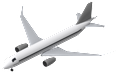
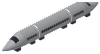
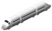
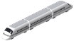
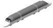
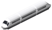

# Vehicle catalogue / 車種型錄 / 車両カタログ

Generated by `tools/catalog.py` from `data/*.csv`. Prices in in-game pounds at default base costs, inflation off.
Images: 2x zoom, south-west view (in game up to 4x).

## Aircraft / 飛機 / 航空機 (49)

| | Vehicle | Year | km/h | Capacity | Runway | Airports | Price | Running / yr |
|---|---|---|---|---|---|---|---|---|
|  | **Boeing 707-320B** 波音 707-320B ボーイング707-320B | 1962 | 897 | 141 pax | 3,050 m | International or larger (large aircraft) | £30,762 | £3,121 |
|  | **Boeing 727-200** 波音 727-200 ボーイング727-200 | 1967 | 917 | 134 pax | 3,080 m | International or larger (large aircraft) | £30,762 | £2,924 |
|  | **Boeing 737-200** 波音 737-200 ボーイング737-200 | 1968 | 780 | 102 pax | 1,860 m | any, including Small and Commuter | £24,610 | £2,446 |
|  | **Boeing 747-100** 波音 747-100 ボーイング747-100 | 1970 | 907 | 452 pax | 3,250 m | Intercontinental (large aircraft) | £90,235 | £7,142 |
|  | **Airbus A300B4** 空中巴士 A300B4 エアバスA300B4 | 1975 | 833 | 266 pax | 2,300 m | City or larger (large aircraft) | £57,422 | £4,471 |
|  | **Aerospatiale/BAC Concorde** 協和號 Concorde コンコルド | 1976 | 2179 | 100 pax | 3,600 m | Intercontinental (large aircraft) | £114,845 | £5,736 |
|  | **Boeing 767-200** 波音 767-200 ボーイング767-200 | 1982 | 851 | 216 pax | 1,920 m | any, including Small and Commuter | £51,270 | £3,627 |
|  | **Boeing 757-200** 波音 757-200 ボーイング757-200 | 1983 | 850 | 200 pax | 2,070 m | any, including Small and Commuter | £47,168 | £3,403 |
|  | **Boeing 737-300** 波音 737-300 ボーイング737-300 | 1984 | 794 | 128 pax | 2,000 m | any, including Small and Commuter | £32,813 | £2,503 |
|  | **Airbus A310-300** 空中巴士 A310-300 エアバスA310-300 | 1985 | 850 | 220 pax | 2,290 m | City or larger (large aircraft) | £51,270 | £3,599 |
|  | **Boeing 767-300ER** 波音 767-300ER ボーイング767-300ER | 1988 | 851 | 269 pax | 2,650 m | City or larger (large aircraft) | £63,575 | £4,106 |
|  | **Boeing 737-400** 波音 737-400 ボーイング737-400 | 1988 | 794 | 146 pax | 2,650 m | City or larger (large aircraft) | £36,914 | £2,643 |
|  | **Airbus A320-200** 空中巴士 A320-200 エアバスA320-200 | 1989 | 828 | 150 pax | 2,100 m | any, including Small and Commuter | £38,965 | £2,671 |
|  | **Boeing 747-400** 波音 747-400 ボーイング747-400 | 1989 | 913 | 524 pax | 2,960 m | International or larger (large aircraft) | £110,743 | £7,058 |
|  | **Airbus A340-300** 空中巴士 A340-300 エアバスA340-300 | 1993 | 871 | 295 pax | 3,000 m | International or larger (large aircraft) | £69,727 | £4,246 |
|  | **Boeing 747-400F** 波音 747-400F ボーイング747-400F | 1993 | 913 | 112 t | 2,910 m | International or larger (large aircraft) | £82,032 | £4,949 |
|  | **Airbus A330-300** 空中巴士 A330-300 エアバスA330-300 | 1994 | 871 | 277 pax | 2,500 m | City or larger (large aircraft) | £65,626 | £3,993 |
|  | **Airbus A321** 空中巴士 A321 エアバスA321 | 1994 | 828 | 185 pax | 2,200 m | City or larger (large aircraft) | £47,168 | £2,953 |
|  | **Airbus A300-600F** 空中巴士 A300-600F エアバスA300-600F | 1994 | 833 | 48 t | 2,470 m | City or larger (large aircraft) | £41,016 | £2,615 |
|  | **Boeing 777-200** 波音 777-200 ボーイング777-200 | 1995 | 905 | 314 pax | 2,440 m | City or larger (large aircraft) | £73,829 | £4,387 |
|  | **Boeing 767-300F** 波音 767-300F ボーイング767-300F | 1995 | 851 | 52 t | 2,650 m | City or larger (large aircraft) | £43,067 | £2,728 |
|  | **Airbus A319** 空中巴士 A319 エアバスA319 | 1996 | 828 | 124 pax | 1,850 m | any, including Small and Commuter | £32,813 | £2,250 |
|  | **Boeing 737-700** 波音 737-700 ボーイング737-700 | 1998 | 842 | 128 pax | 2,040 m | any, including Small and Commuter | £34,864 | £2,250 |
|  | **Boeing 737-800** 波音 737-800 ボーイング737-800 | 1998 | 842 | 162 pax | 2,320 m | City or larger (large aircraft) | £43,067 | £2,615 |
|  | **Airbus A330-200** 空中巴士 A330-200 エアバスA330-200 | 1998 | 871 | 247 pax | 2,220 m | City or larger (large aircraft) | £61,524 | £3,543 |
|  | **Boeing 757-300** 波音 757-300 ボーイング757-300 | 1999 | 850 | 243 pax | 2,610 m | City or larger (large aircraft) | £61,524 | £3,459 |
|  | **Airbus A340-600** 空中巴士 A340-600 エアバスA340-600 | 2002 | 871 | 380 pax | 3,400 m | Intercontinental (large aircraft) | £90,235 | £4,809 |
|  | **Airbus A318** 空中巴士 A318 エアバスA318 | 2003 | 828 | 107 pax | 1,780 m | any, including Small and Commuter | £30,762 | £1,940 |
|  | **Boeing 777-300ER** 波音 777-300ER ボーイング777-300ER | 2004 | 905 | 396 pax | 3,050 m | International or larger (large aircraft) | £94,337 | £4,893 |
|  | **Boeing 737-900ER** 波音 737-900ER ボーイング737-900ER | 2007 | 842 | 178 pax | 2,990 m | International or larger (large aircraft) | £49,219 | £2,587 |
|  | **Airbus A380-800** 空中巴士 A380-800 エアバスA380-800 | 2007 | 903 | 525 pax | 3,000 m | International or larger (large aircraft) | £120,997 | £6,074 |
|  | **Boeing 777F** 波音 777F ボーイング777F | 2009 | 905 | 102 t | 2,830 m | International or larger (large aircraft) | £82,032 | £3,993 |
|  | **Airbus A330-200F** 空中巴士 A330-200F エアバスA330-200F | 2010 | 871 | 70 t | 2,400 m | City or larger (large aircraft) | £59,473 | £2,953 |
|  | **Boeing 747-8F** 波音 747-8F ボーイング747-8F | 2011 | 917 | 134 t | 3,100 m | International or larger (large aircraft) | £104,591 | £4,921 |
|  | **Boeing 787-8** 波音 787-8 ボーイング787-8 | 2011 | 903 | 248 pax | 2,590 m | City or larger (large aircraft) | £65,626 | £3,149 |
|  | **Boeing 747-8 Intercontinental** 波音 747-8 洲際型 ボーイング747-8インターコンチネンタル | 2012 | 917 | 410 pax | 3,100 m | International or larger (large aircraft) | £100,489 | £4,696 |
|  | **Boeing 787-9** 波音 787-9 ボーイング787-9 | 2014 | 903 | 296 pax | 2,830 m | International or larger (large aircraft) | £75,880 | £3,515 |
|  | **Airbus A350-900** 空中巴士 A350-900 エアバスA350-900 | 2015 | 903 | 325 pax | 2,600 m | City or larger (large aircraft) | £84,083 | £3,768 |
|  | **Airbus A320neo** 空中巴士 A320neo エアバスA320neo | 2016 | 828 | 165 pax | 1,950 m | any, including Small and Commuter | £47,168 | £2,250 |
|  | **Boeing 737 MAX 8** 波音 737 MAX 8 ボーイング737 MAX 8 | 2017 | 839 | 172 pax | 2,530 m | City or larger (large aircraft) | £49,219 | £2,306 |
|  | **Airbus A321neo** 空中巴士 A321neo エアバスA321neo | 2017 | 828 | 206 pax | 2,200 m | City or larger (large aircraft) | £57,422 | £2,615 |
|  | **Airbus A350-1000** 空中巴士 A350-1000 エアバスA350-1000 | 2018 | 903 | 366 pax | 2,800 m | International or larger (large aircraft) | £94,337 | £4,077 |
|  | **Boeing 737 MAX 9** 波音 737 MAX 9 ボーイング737 MAX 9 | 2018 | 839 | 193 pax | 2,590 m | City or larger (large aircraft) | £53,321 | £2,503 |
|  | **Boeing 787-10** 波音 787-10 ボーイング787-10 | 2018 | 903 | 336 pax | 2,770 m | International or larger (large aircraft) | £86,134 | £3,824 |
|  | **Airbus A330-900** 空中巴士 A330-900 エアバスA330-900 | 2018 | 871 | 287 pax | 3,000 m | International or larger (large aircraft) | £75,880 | £3,374 |
|  | **Airbus BelugaXL** 空中巴士 BelugaXL エアバス ベルーガXL | 2020 | 737 | 51 t | 2,500 m | City or larger (large aircraft) | £47,168 | £2,221 |
|  | **Airbus A321XLR** 空中巴士 A321XLR エアバスA321XLR | 2024 | 828 | 200 pax | 2,500 m | City or larger (large aircraft) | £57,422 | £2,559 |
|  | **Boeing 777-9** 波音 777-9 ボーイング777-9 | 2027 | 905 | 426 pax | 3,050 m | International or larger (large aircraft) | £110,743 | £4,640 |
|  | **Airbus A350F** 空中巴士 A350F エアバスA350F | 2027 | 903 | 111 t | 2,800 m | International or larger (large aircraft) | £94,337 | £3,993 |

## Trains / 列車 / 列車 (31)

| | Vehicle | Year | km/h | Cars × seats | Platform | Power | Price | Running / yr |
|---|---|---|---|---|---|---|---|---|
|  | **0 Series Shinkansen** 0 系新幹線 0系新幹線 | 1964 | 220 | 16 × 84 | 8 tiles | 11,840 kW | £107,815 | £2,965 |
|  | **0 Series Shinkansen (12 cars)** 0 系新幹線（12 輛） 0系新幹線（12両） | 1964 | 220 | 12 × 84 | 6 tiles | 8,880 kW | £80,861 | £2,529 |
|  | **200 Series Shinkansen** 200 系新幹線 200系新幹線 | 1982 | 240 | 12 × 74 | 6 tiles | 11,040 kW | £80,861 | £2,417 |
|  | **100 Series Shinkansen** 100 系新幹線 100系新幹線 | 1985 | 220 | 16 × 83 | 8 tiles | 11,040 kW | £116,018 | £2,950 |
|  | **300 Series Shinkansen** 300 系新幹線 300系新幹線 | 1992 | 270 | 16 × 83 | 8 tiles | 12,000 kW | £132,425 | £3,133 |
|  | **400 Series Shinkansen** 400 系新幹線 400系新幹線 | 1992 | 240 | 7 × 57 | 3 tiles | 5,040 kW | £37,501 | £1,742 |
|  | **E1 Series Shinkansen Max** E1 系新幹線 Max E1系新幹線 Max | 1994 | 240 | 12 × 103 | 6 tiles | 9,840 kW | £117,190 | £2,894 |
|  | **500 Series Shinkansen** 500 系新幹線 500系新幹線 | 1997 | 300 | 16 × 83 | 8 tiles | 18,240 kW | £142,972 | £3,232 |
|  | **E2 Series Shinkansen** E2 系新幹線 E2系新幹線 | 1997 | 275 | 10 × 81 | 5 tiles | 9,600 kW | £83,205 | £2,388 |
|  | **E3 Series Shinkansen** E3 系新幹線 E3系新幹線 | 1997 | 275 | 6 × 56 | 3 tiles | 4,800 kW | £33,985 | £1,700 |
|  | **E4 Series Shinkansen Max** E4 系新幹線 Max E4系新幹線 Max | 1997 | 240 | 8 × 102 | 4 tiles | 6,720 kW | £78,517 | £2,318 |
|  | **700 Series Shinkansen** 700 系新幹線 700系新幹線 | 1999 | 285 | 16 × 83 | 8 tiles | 13,200 kW | £140,628 | £3,189 |
|  | **700 Series Shinkansen Hikari Rail Star (8 cars)** 700 系新幹線 Hikari Rail Star（8 輛） 700系新幹線ひかりレールスター（8両） | 2000 | 285 | 8 × 71 | 4 tiles | 6,600 kW | £59,767 | £2,051 |
|  | **923 Series Doctor Yellow** 923 型 Doctor Yellow 923形ドクターイエロー | 2001 | 270 | 7 × 20 | 4 tiles | 6,600 kW | £14,063 | £1,405 |
|  | **Transrapid SMT** Transrapid 上海磁浮 トランスラピッドSMT | 2004 | 430 | 5 × 89 | 3 tiles | 10,000 kW | £93,752 | £3,232 |
|  | **800 Series Shinkansen** 800 系新幹線 800系新幹線 | 2004 | 260 | 6 × 65 | 3 tiles | 6,600 kW | £39,845 | £1,756 |
|  | **HSST-100L Linimo** HSST-100L Linimo HSST-100L リニモ | 2005 | 100 | 3 × 35 | 1 tiles | 1,500 kW | £8,203 | £1,489 |
|  | **N700 Series Shinkansen** N700 系新幹線 N700系新幹線 | 2007 | 300 | 16 × 83 | 8 tiles | 17,080 kW | £147,659 | £3,232 |
|  | **Transrapid 09** Transrapid 09 トランスラピッド09 | 2008 | 500 | 3 × 50 | 2 tiles | 6,000 kW | £35,157 | £2,388 |
|  | **500 Series Shinkansen (8 cars)** 500 系新幹線（8 輛） 500系新幹線（8両） | 2008 | 285 | 8 × 76 | 4 tiles | 9,120 kW | £66,798 | £2,108 |
|  | **E5 Series Shinkansen** E5 系新幹線 E5系新幹線 | 2011 | 320 | 10 × 73 | 5 tiles | 9,600 kW | £85,549 | £2,360 |
|  | **N700 Series Shinkansen (8 cars)** N700 系新幹線（8 輛） N700系新幹線（8両） | 2011 | 300 | 8 × 68 | 4 tiles | 9,760 kW | £62,111 | £2,037 |
|  | **N700A Series Shinkansen** N700A 系新幹線 N700A系新幹線 | 2013 | 300 | 16 × 83 | 8 tiles | 17,080 kW | £151,175 | £3,232 |
|  | **E6 Series Shinkansen** E6 系新幹線 E6系新幹線 | 2013 | 320 | 7 × 48 | 3 tiles | 6,000 kW | £39,845 | £1,728 |
|  | **E7 Series Shinkansen** E7 系新幹線 E7系新幹線 | 2014 | 275 | 12 × 78 | 6 tiles | 12,000 kW | £103,127 | £2,571 |
|  | **Beijing Metro Line S1 Maglev** 北京地鐵 S1 線磁浮 北京地下鉄S1線リニア | 2017 | 80 | 6 × 31 | 2 tiles | 3,600 kW | £12,891 | £1,503 |
|  | **N700S Series Shinkansen** N700S 系新幹線 N700S系新幹線 | 2020 | 300 | 16 × 83 | 8 tiles | 17,080 kW | £155,863 | £3,232 |
|  | **CRRC 600 km/h Maglev** 中車 600 km/h 高速磁浮 中国中車600km/hリニア | 2021 | 600 | 5 × 100 | 3 tiles | 15,000 kW | £132,425 | £3,583 |
|  | **E8 Series Shinkansen** E8 系新幹線 E8系新幹線 | 2024 | 300 | 7 × 51 | 3 tiles | 6,000 kW | £42,188 | £1,742 |
|  | **L0 Series SCMaglev** L0 系超導磁浮 L0系 | 2027 | 500 | 12 × 61 | 6 tiles | 20,000 kW | £180,473 | £3,583 |
|  | **L0 Series SCMaglev (16 cars)** L0 系超導磁浮（16 輛） L0系（16両） | 2027 | 500 | 16 × 63 | 8 tiles | 26,000 kW | £249,615 | £3,583 |

