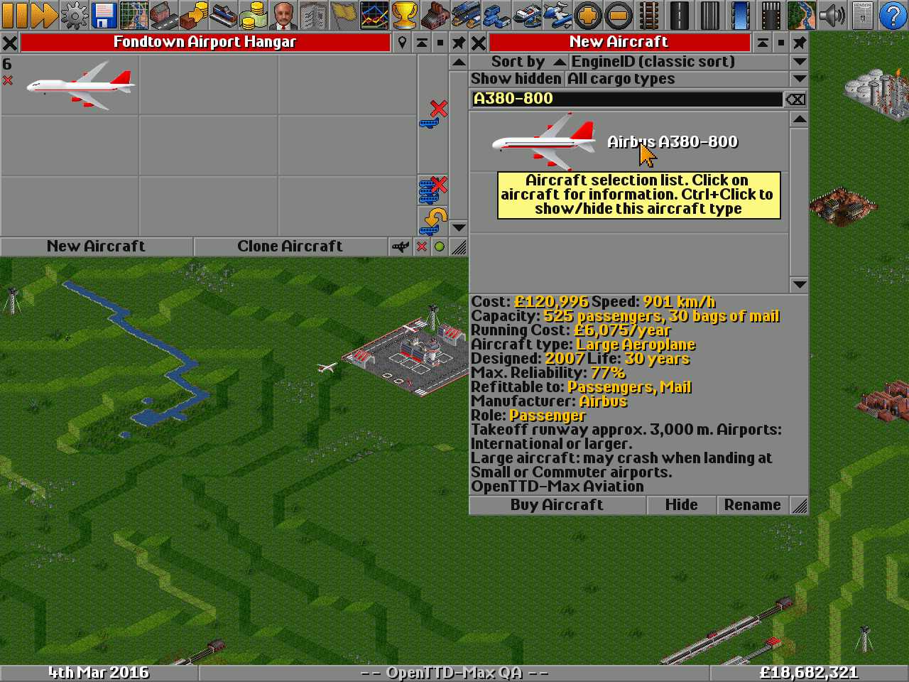
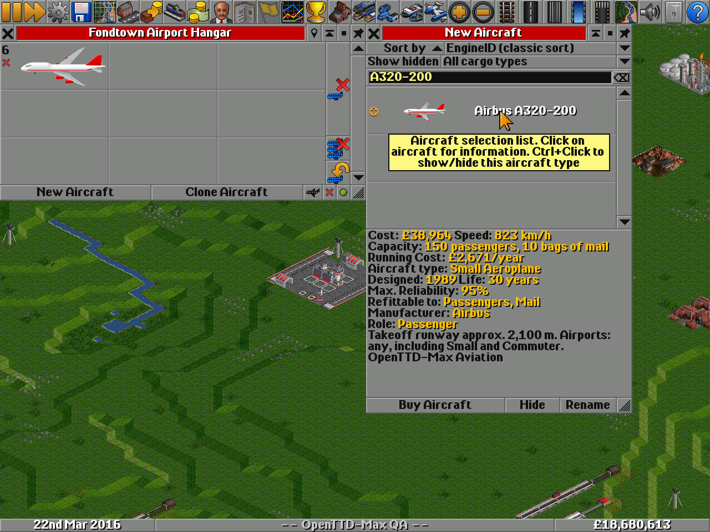
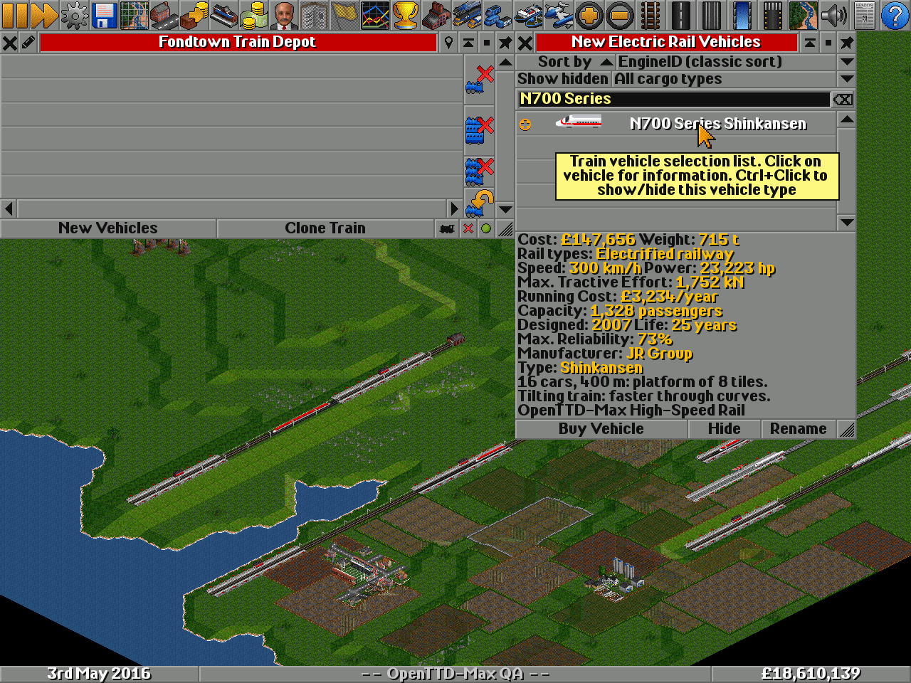
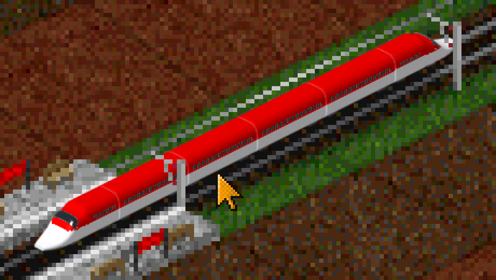
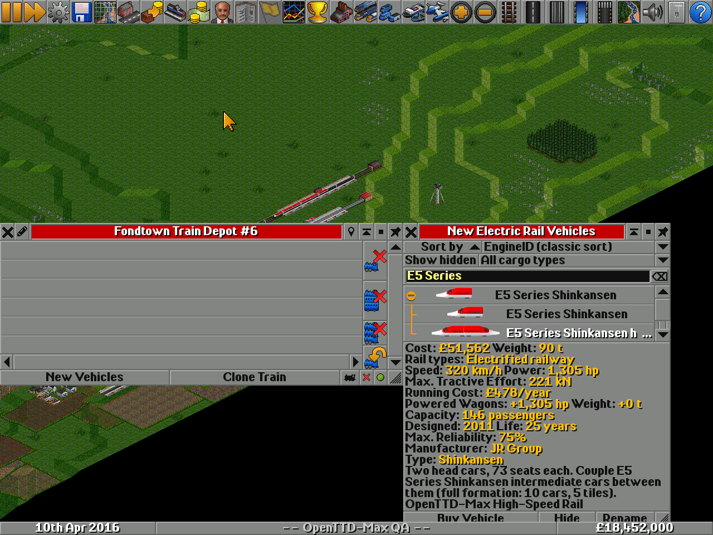
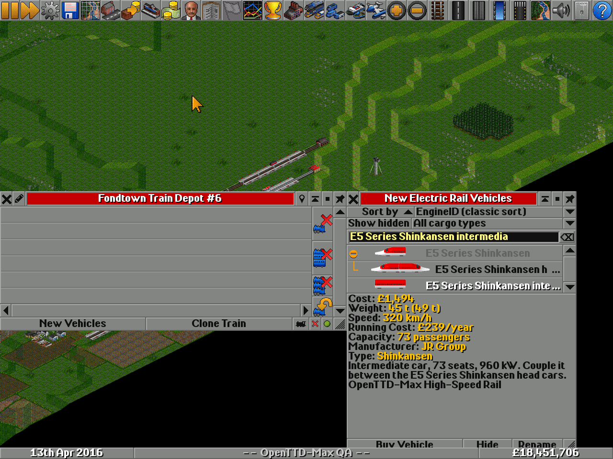
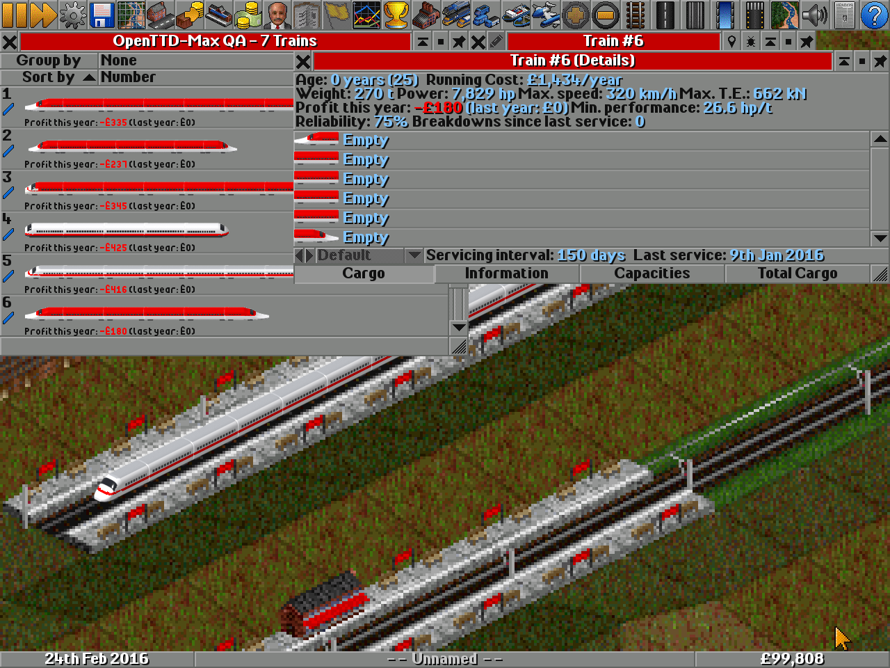

# M5 報告：裝卸速度、跑道與機場等級、音效、自由編組

| 項目 | 內容 |
|---|---|
| 日期 | 2026-10-15 |
| 目標 | 使用者回饋：裝卸太慢、依飛機大小標示跑道與機場、加入起降音效、新幹線可分開買車頭與車廂 |
| 結果 | 四項**完成**並在 OpenTTD 15.3 實機驗證；GRF 版本 3，舊存檔相容 |

## 1. 裝卸速度

**原因**：NewGRF 車輛若沒設 `loading_speed`，OpenTTD 的 `load_amount` 為 0，裝卸時被夾成每步 1 單位（`GetLoadAmount()`：
`std::max(1u, load_amount)`）。飛機每 20 tick 一步、列車每 40 tick 一步（一天 74 tick），所以 416 座的 747 要
416 步 ≈ 112 天才裝滿；N700 每節 83 座要 45 天。原版車輛固定每步 20（飛機）/ 5（列車）。

**修正**：每款車設 `loading_speed = ceil(容量 / 8)` 作為基本值，再用 callback 36 依 GRF 參數「裝卸速度」計算：

| 參數值 | 每步裝卸量 | 裝滿所需 |
|---|---|---|
| 標準（預設） | ceil(容量 / 8) | 8 步：飛機約 2.2 天、列車約 4.3 天 |
| 快 | ceil(容量 / 4) | 4 步 |
| 很快 | ceil(容量 / 2) | 2 步 |
| 原版 | 固定 20（飛機）/ 每節 5（列車） | 原版車輛的速度，大型機很慢 |

列車的 callback 以每節車廂為單位（`cargo_capacity` 是該節的容量），飛機的郵件艙也各自算。只有遊戲設定「漸進式裝卸」開啟時
才會用到 callback；關閉時本來就一步裝滿。

**驗證**：測試 AI 在 Fondtown（199 人）旁建站並以公車站併入車站取得乘客，每 5 tick 記錄載客量。E5 進站後第一個樣本就載了
24 人、A380 載了 9 人（舊版每步只能裝 1 人）；所有進站停留都在 5–10 tick 內結束，因為候車乘客一步就裝完。

## 2. 跑道長度與機場等級

`data/aircraft.csv` 新增 `runway_m`（最大起飛重量、海平面標準大氣的起飛場地長度）與選填的 `airport_class`。數值依各型號
公開的機型特性表查證（Boeing / Airbus 變體表換算），無公開數據的五款（777-9、A321XLR、A330-200F、A350F、BelugaXL）為估計值，
並在 notes 註明。

OpenTTD 本身只分「小型機」（任何機場都安全）和「大型機」（在小機場、通勤機場降落有 3276/2^22 ≈ 0.08% 的墜機率，
設定「飛機失事」為「無」時不會）。本套件以 2,100 m 為界：

| 起飛跑道 | 遊戲旗標 | 購買視窗建議 | 機型 |
|---|---|---|---|
| ≤ 2,100 m | 小型機 | 全部機場（含小機場、通勤機場） | 737-200/-300/-700、757-200、767-200、A318、A319、A320、A320neo |
| 2,101–2,700 m | 大型機 | 城市機場以上 | 737-400/-800/MAX、757-300、767-300、777-200、787-8、A300、A310、A321、A330、A350-900… |
| 2,701–3,100 m | 大型機 | 國際機場以上 | 707、727、737-900ER、747-400/-8、777-300ER/F/-9、787-9/-10、A330-900、A340-300、A350-1000、A380 |
| > 3,100 m | 大型機 | 洲際機場 | 協和號（3,600 m）、747-100、A340-600 |

只有小型 / 大型旗標是遊戲機制；「城市機場以上」等等級是建議文字，遊戲不會阻止大型機使用城市機場。購買視窗（`additional_text`
callback）顯示「起飛跑道約 N 公尺。適用機場：…」，大型機再加一行墜機風險提醒；列車則顯示編組節數、全長與所需月台格數
（16 節 25 m 車廂 = 8 格），傾斜列車加註。三種語言都有。

## 3. 音效

`tools/make_sounds.py` 以 numpy 合成六個 22,050 Hz / 16-bit 單聲道 WAV（無錄音、無授權問題）：

| 檔案 | 用途 | 長度 |
|---|---|---|
| jet_takeoff.wav | 窄體機起飛（sound = jet） | 3.0 s |
| jet_takeoff_big.wav | 廣體 / 四發起飛（jet_big） | 3.6 s |
| concorde_takeoff.wav | 協和號後燃器（jet_fast） | 4.0 s |
| touchdown.wav | 所有飛機觸地 | 1.0 s |
| shinkansen_depart.wav | 新幹線發車三音鈴（自創旋律） | 1.7 s |
| maglev_depart.wav | 磁浮發車電磁嗡鳴 | 2.0 s |

NML 用 `sound()` 嵌入 GRF，`sound_effect` callback 依事件（`SOUND_EVENT_START`、`SOUND_EVENT_TOUCHDOWN`）回傳；
GRF 參數「音效」選遊戲原版時 callback 回 `CB_FAILED`，退回 `sound_effect` 屬性的原版音效。參數值 0 = 本套件音效，
所以舊存檔（參數未設定、讀到 0）也會播放新音效。

**驗證**：QA 工具新增 `--sound-driver sdl`，配合 `SDL_AUDIODRIVER=disk` 把遊戲混音輸出寫成 raw 檔，`tools/ingame/audio_check.py`
以正規化互相關比對每個 WAV（依 OpenTTD mixer 的 sample-and-hold 方式升頻）。視窗停在機場 191 秒：jet_takeoff 6 次
（相關係數 0.88–0.96）、jet_takeoff_big 10 次（0.91–0.97）、touchdown 15 次；停在車站 712 秒：新幹線鈴聲 147 次、磁浮 44 次
（最高 1.00）。音效只在車輛位於視窗內時播放，這是 OpenTTD 的規則。

## 4. 自由編組

使用者回饋：固定編組一買就是 10–16 節，月台裝不下。每個車系（依圖檔分 24 系）新增兩個購買項目：

- **先頭車 ×2**：`dual_headed` 機車。OpenTTD 會自動把後端畫成反向的先頭車（`IS_CUSTOM_SECONDHEAD_SPRITE`），拖車廂進去時
  後端自動移到最後（`NormaliseDualHeads`）。功率 = 兩節的功率（雙頭機車的後半不加功率）、重量兩節、載客兩節。
- **中間車**：車廂，速度 / 重量 / 載客 / 傾斜旗標與該系列相同。先頭車項目用 `livery_override` 指定它的圖，使它成為
  OpenTTD 的「有動力車廂」，再以 `extra_power_per_wagon` 每節加上一節的功率，滿編時功率與固定編組相同。
- **加掛限制**：`can_attach_wagon` callback 只接受同系列中間車，其他車廂顯示「只能加掛 ○○ 中間車」。
- **參數「編組方式」**：固定 + 自由（預設）/ 只有固定 / 只有自由。先頭車列在固定編組的變體群組之下。
- **價格**：見 docs/BALANCE.md「自由編組」。中間車受 OpenTTD 車廂基價限制（每節約 £1,500）。

**驗證**（OpenTTD 15.3，測試 AI）：E5 先頭車 + 4 節中間車 → 6 節、載客 438（6 × 73）、重 270 t、功率 7,829 hp
（6 節份，先頭車組 £51,562 + 中間車每節 £1,494），兩端都是先頭車；Transrapid SMT 先頭車 + 2 節 → 4 節、載客 356。
把 E6 中間車拖到 E5 編組：被拒絕。

## 5. 工具

- `tools/make_sounds.py`、`make sounds`：合成音效。
- `tools/ingame/run.py --sound-driver sdl`、`tools/ingame/audio_check.py`：錄音與比對。
- 測試 AI `near_town=1`：在最大城鎮旁建站並以公車站併入（`station_spread = 64`），記錄 `MAXTEST ld` 載客進度；
  `BuildFreeTrain` / `CheckAttach` 測自由編組。
- `tools/catalog.py`：型錄新增跑道 / 機場、月台欄。

## 6. 後續玩法構想

1. **艙等 refit**：以 `cargo_subtype` 提供「全經濟 / 兩艙 / 三艙」佈局，座位數與票價（`cargo_age_period`）不同。
2. **貨物老化**：高速列車與超音速機設較長的 `cargo_age_period`，等於更高票價，讓協和號與新幹線的速度真正值錢。
3. **航程系統**：`range` 屬性依機型分區域 / 中程 / 長程，GRF 參數可關；短程機飛不了跨地圖航線。
4. **年代 badges**：`era/1960s` … 方便篩選；`livery` 變體（世代塗裝）。
5. **月台長度提示**：車站蓋好後用車輛清單的「長度」欄比對（OpenTTD 15 內建）；本套件已在購買視窗標示格數。
6. **機場容量**：搭配機場套件（如 OpenGFX+ Airports）才有更長跑道與更多停機位，本套件的建議等級以原版機場命名。
7. **Doctor Yellow 任務**：以 GameScript 給檢測列車定期巡迴的獎勵（屬 GS 範圍，非 NewGRF）。
8. **飛機速度設定**：原版「飛機速度係數」預設 1/4，調到 1/1 飛行時間才接近真實；本套件不改設定，建議在說明提醒。

## 7. 限制

- 跑道等級只有小 / 大型是遊戲機制，其餘為建議；OpenTTD 沒有跑道長度模擬。
- 音效為合成，不是真實錄音；可自行以同名 WAV 取代（PCM 單聲道 8/16-bit）再 `make`。
- 自由編組的中間車只能掛在本套件的先頭車上；但原版機車可以拉本套件的中間車（OpenTTD 的 callback 只在機車端）。
- 遊戲進行中切換「編組方式」會讓被停用類型的列車消失；請在新局設定。
- 參數「裝卸速度」只在「漸進式裝卸」開啟時有效。
