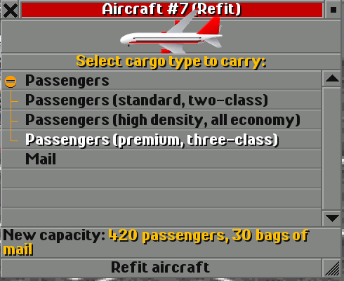
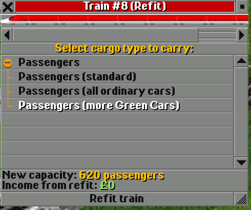

# M6 報告：艙等配置 refit、貨物老化

| 項目 | 內容 |
|---|---|
| 日期 | 2026-10-15 |
| 目標 | M5 §6 的兩項構想：艙等 refit、貨物老化（使用者：「都照你的建議，繼續做」） |
| 結果 | 兩項**完成**並在 OpenTTD 15.3 實機驗證；GRF 版本 3，舊存檔相容（新參數讀到預設值） |

## 1. 艙等配置（refit 子類型）

NewGRF 可以對同一種貨物提供多個 refit 子類型（`cargo_subtype_text` callback），容量（callback 15）與其他屬性再依
`cargo_subtype` 變化。本套件對乘客提供三種配置，在機庫 / 機廠的改裝視窗選擇（改裝免費）：

| | 飛機 | 列車 | 座位 | 老化週期 |
|---|---|---|---|---|
| 0 | 標準（兩艙等，CSV 的 pax） | 標準 | ×1.0 | ×1.0 |
| 1 | 高密度（全經濟艙） | 全普通車 | ×1.15 / ×1.12 | ×0.75 |
| 2 | 豪華（三艙等） | 綠色車廂加強 | ×0.8 / ×0.85 | ×2.0 |

郵件艙不受影響；貨機沒有子類型。OpenTTD 把子類型文字直接接在貨物名稱後面，所以字串自帶「 (…)」。只有乘客有子類型：
`cargo_type_in_veh` 經 `cargotable { PASS, MAIL }` 判斷。自由編組的先頭車與中間車共用該系列的容量 / 老化 switch。

實測：A380 標準 525 / 高密度 604 / 豪華 420 座（郵件 30 袋不變）；E5 10 輛 730 / 820 / 620 座。

## 2. 貨物老化

OpenTTD 的票價只看距離、運輸時間與貨物種類，不能對頭等艙收更高票價；`cargo_age_period` 是車輛唯一能影響票價的屬性
（時間係數每個週期減 1/255）。`tools/balance.py` 依車種分級：協和號 ×2、廣體機（pax ≥ 250）×1.25、新幹線（≥ 270 km/h）×1.25、
高速磁浮（≥ 400 km/h）×1.5，再乘艙等係數，由 callback 36 回傳；參數「乘客舒適度」關閉時全部回到預設 185。

效果刻意溫和（docs/BALANCE.md 有表）：40 天航程 2 倍週期約 +3%，100 天約 +18%。高密度配置在大多數航線最賺；豪華配置
要極長途才接近打平，主要是風味。這是誠實的結論：在 OpenTTD 的經濟模型裡「艙等」做不成賺錢機制。

## 3. 實作

- `tools/gen_nml.py`：`CABINS`、`cabin_text_switch()`、`cabin_switches()`（每款車 `sw_<id>_cap`、`sw_<id>_age_cabin`、
  `sw_<id>_age`），購買視窗多一行說明。
- `tools/balance.py`：`cargo_age_period()`、`AGE_FACTORS`。
- `src/*.pnml`：`cargotable { PASS, MAIL }`、參數 `param_aging`（飛機第 4 個、列車第 5 個參數）。
- 三種語言的 `STR_CABIN_*`、`STR_PARAM_AGING_*`。

## 4. 限制

- 艙等只改座位與老化，不改票價單價；豪華配置通常比標準少賺。
- 老化週期只影響乘客（郵件、貨物沿用預設）。
- 改裝要在機庫 / 機廠內停車後進行（OpenTTD 規則）。
