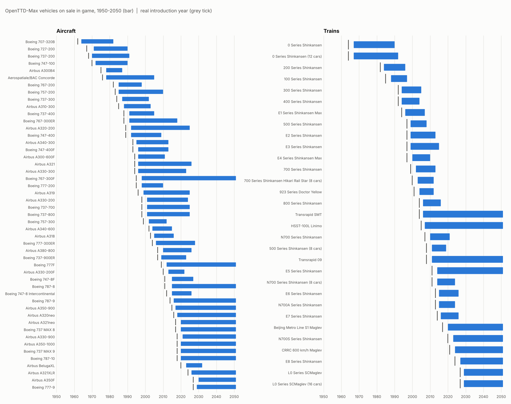

# Timeline test (generated by tools/timeline_report.py)

One OpenTTD 15.3 game from 1950 to 2050 at unlimited fast-forward, both NewGRFs loaded with
default parameters. The test AI logged the buildable engines every January.

OpenTTD delays every new engine by a random 0-1.4 years and then offers it to one company for a
one-year exclusive preview, so with January sampling a vehicle shows up 1-3 years after its real
introduction year (the purchase list still shows the real design year).

## On sale per decade

| Year | OpenTTD-Max aircraft | OpenTTD-Max trains | Original aircraft | Original trains |
|---|---|---|---|---|
| 1950 | 0 | 0 | 3 | 3 |
| 1960 | 0 | 0 | 5 | 5 |
| 1970 | 2 | 2 | 11 | 8 |
| 1980 | 6 | 2 | 12 | 8 |
| 1990 | 6 | 3 | 18 | 10 |
| 2000 | 16 | 7 | 19 | 9 |
| 2010 | 18 | 9 | 14 | 7 |
| 2020 | 24 | 10 | 14 | 6 |
| 2030 | 16 | 10 | 10 | 6 |
| 2040 | 15 | 10 | 8 | 8 |
| 2050 | 15 | 10 | 9 | 8 |

## Every vehicle

| Vehicle | Type | Real introduction | First on sale | Last on sale |
|---|---|---|---|---|
| Aerospatiale/BAC Concorde | aircraft | 1976 | 1978 | 2004 |
| Boeing 707-320B | aircraft | 1962 | 1964 | 1981 |
| Boeing 727-200 | aircraft | 1967 | 1971 | 1989 |
| Boeing 737-200 | aircraft | 1968 | 1970 | 1990 |
| Boeing 737-300 | aircraft | 1984 | 1987 | 2001 |
| Boeing 737-400 | aircraft | 1988 | 1991 | 2004 |
| Boeing 737-700 | aircraft | 1998 | 2001 | 2024 |
| Boeing 737-800 | aircraft | 1998 | 2001 | 2024 |
| Boeing 737-900ER | aircraft | 2007 | 2009 | 2022 |
| Boeing 737 MAX 8 | aircraft | 2017 | 2020 | 2050+ |
| Boeing 737 MAX 9 | aircraft | 2018 | 2020 | 2050+ |
| Boeing 747-100 | aircraft | 1970 | 1972 | 1989 |
| Boeing 747-400 | aircraft | 1989 | 1992 | 2008 |
| Boeing 747-400F | aircraft | 1993 | 1996 | 2012 |
| Boeing 747-8 Intercontinental | aircraft | 2012 | 2015 | 2025 |
| Boeing 747-8F | aircraft | 2011 | 2015 | 2026 |
| Boeing 757-200 | aircraft | 1983 | 1985 | 2009 |
| Boeing 757-300 | aircraft | 1999 | 2002 | 2011 |
| Boeing 767-200 | aircraft | 1982 | 1985 | 1997 |
| Boeing 767-300ER | aircraft | 1988 | 1991 | 2017 |
| Boeing 767-300F | aircraft | 1995 | 1998 | 2050+ |
| Boeing 777-200 | aircraft | 1995 | 1998 | 2009 |
| Boeing 777-300ER | aircraft | 2004 | 2006 | 2027 |
| Boeing 777F | aircraft | 2009 | 2012 | 2050+ |
| Boeing 777-9 | aircraft | 2027 | 2029 | 2050+ |
| Boeing 787-8 | aircraft | 2011 | 2015 | 2050+ |
| Boeing 787-9 | aircraft | 2014 | 2016 | 2050+ |
| Boeing 787-10 | aircraft | 2018 | 2020 | 2050+ |
| Airbus A300B4 | aircraft | 1975 | 1978 | 1986 |
| Airbus A300-600F | aircraft | 1994 | 1996 | 2010 |
| Airbus A310-300 | aircraft | 1985 | 1988 | 2002 |
| Airbus A320-200 | aircraft | 1989 | 1992 | 2024 |
| Airbus A318 | aircraft | 2003 | 2005 | 2015 |
| Airbus A319 | aircraft | 1996 | 1999 | 2024 |
| Airbus A321 | aircraft | 1994 | 1996 | 2025 |
| Airbus A320neo | aircraft | 2016 | 2018 | 2050+ |
| Airbus A321neo | aircraft | 2017 | 2020 | 2050+ |
| Airbus A321XLR | aircraft | 2024 | 2026 | 2050+ |
| Airbus A330-300 | aircraft | 1994 | 1996 | 2022 |
| Airbus A330-200 | aircraft | 1998 | 2001 | 2023 |
| Airbus A330-200F | aircraft | 2010 | 2013 | 2021 |
| Airbus A330-900 | aircraft | 2018 | 2021 | 2050+ |
| Airbus A340-300 | aircraft | 1993 | 1995 | 2012 |
| Airbus A340-600 | aircraft | 2002 | 2004 | 2014 |
| Airbus A350-900 | aircraft | 2015 | 2017 | 2050+ |
| Airbus A350-1000 | aircraft | 2018 | 2020 | 2050+ |
| Airbus A350F | aircraft | 2027 | 2030 | 2050+ |
| Airbus A380-800 | aircraft | 2007 | 2010 | 2025 |
| Airbus BelugaXL | aircraft | 2020 | 2023 | 2031 |
| 0 Series Shinkansen | train | 1964 | 1967 | 1989 |
| 0 Series Shinkansen (12 cars) | train | 1964 | 1967 | 1991 |
| 200 Series Shinkansen | train | 1982 | 1984 | 1995 |
| 100 Series Shinkansen | train | 1985 | 1988 | 1996 |
| 300 Series Shinkansen | train | 1992 | 1994 | 2004 |
| 400 Series Shinkansen | train | 1992 | 1994 | 2003 |
| E1 Series Shinkansen Max | train | 1994 | 1996 | 2006 |
| 500 Series Shinkansen | train | 1997 | 1999 | 2007 |
| 500 Series Shinkansen (8 cars) | train | 2008 | 2011 | 2018 |
| E2 Series Shinkansen | train | 1997 | 1999 | 2012 |
| E3 Series Shinkansen | train | 1997 | 1999 | 2014 |
| E4 Series Shinkansen Max | train | 1997 | 2000 | 2009 |
| 700 Series Shinkansen | train | 1999 | 2002 | 2012 |
| 700 Series Shinkansen Hikari Rail Star (8 cars) | train | 2000 | 2003 | 2011 |
| 923 Series Doctor Yellow | train | 2001 | 2004 | 2011 |
| 800 Series Shinkansen | train | 2004 | 2006 | 2015 |
| N700 Series Shinkansen | train | 2007 | 2010 | 2020 |
| N700 Series Shinkansen (8 cars) | train | 2011 | 2014 | 2023 |
| N700A Series Shinkansen | train | 2013 | 2015 | 2023 |
| E5 Series Shinkansen | train | 2011 | 2014 | 2050+ |
| E6 Series Shinkansen | train | 2013 | 2015 | 2025 |
| E7 Series Shinkansen | train | 2014 | 2016 | 2025 |
| N700S Series Shinkansen | train | 2020 | 2023 | 2050+ |
| E8 Series Shinkansen | train | 2024 | 2027 | 2050+ |
| Transrapid SMT | train | 2004 | 2006 | 2050+ |
| Transrapid 09 | train | 2008 | 2011 | 2050+ |
| HSST-100L Linimo | train | 2005 | 2007 | 2050+ |
| Beijing Metro Line S1 Maglev | train | 2017 | 2020 | 2050+ |
| CRRC 600 km/h Maglev | train | 2021 | 2024 | 2050+ |
| L0 Series SCMaglev | train | 2027 | 2029 | 2050+ |
| L0 Series SCMaglev (16 cars) | train | 2027 | 2029 | 2050+ |

## Findings

- Every vehicle went on sale within 3.5 years of its real introduction date and stayed on sale without gaps.
- From 1964 (aircraft) and 1967 (trains) on, at least one OpenTTD-Max vehicle was on sale every year.
- No NewGRF errors or warnings in the game log.
- The game logged every year from 1950 to 2050: no crash or stall.
